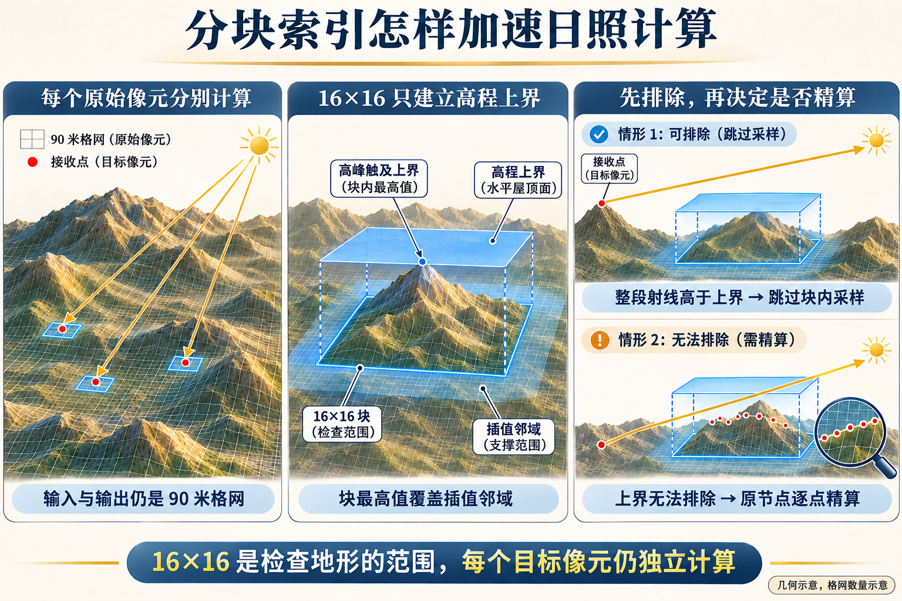
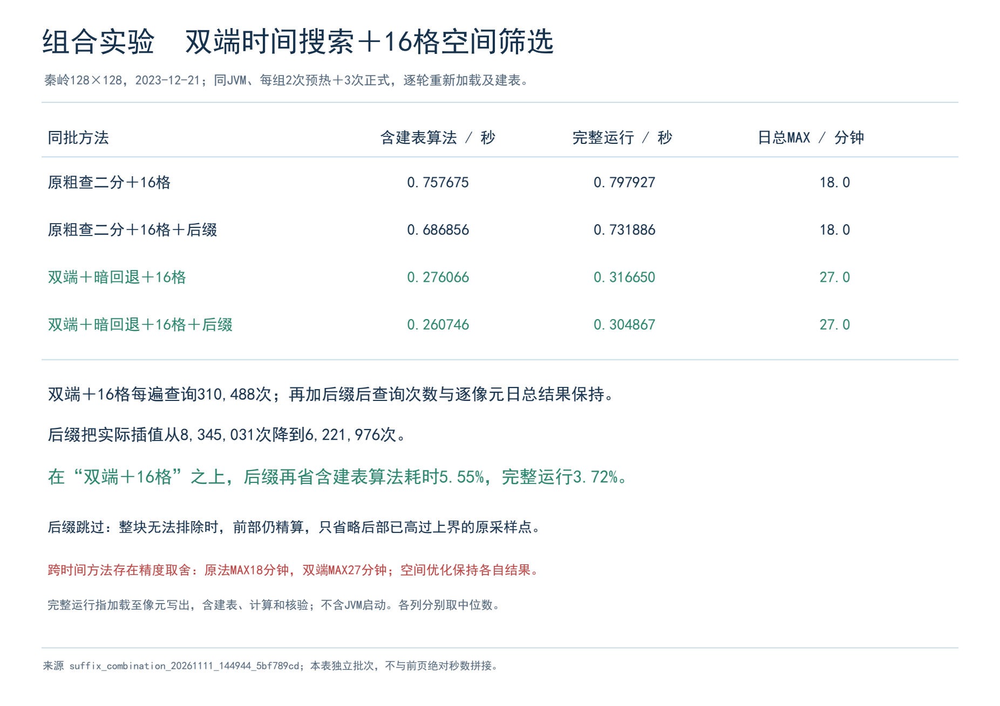

# 日照计算方法说明与实验结果（修订版）

整理日期 2026-11-16；GitHub快照更新2026-11-17。详细数字另见[可检索结果表](EXPERIMENT_RESULTS_2026-11-17.md)。方法对照与空间分块各自完整说明，实验与失败案例集中呈现。

## 1  研究问题与共同约定

先说明计算对象，后面的三种时间方法共用本页约定。

研究要计算某个目标像元在指定日期内，太阳有多长时间没有被地形遮挡。时间方法决定一天查哪些时刻，空间分块决定每次查询怎样少做地形插值。

每个像元采用从天文日出到天文日落的时间轴。记日出为 t=0，日落为 t=D，D 是白昼长度，单位为分钟。昼中取 floor(D/2)，因此程序里的“中点”不是直接取北京时间 12 点。

查询某时刻后，得到明、暗或未知。明记为1，暗记为0。对实际参与积分的节点按时间排序，相邻节点贡献为“时间差 × 两端状态平均值”，再求和得到日照时长。异态相邻节点的等效边界位于两节点中点。遇到参与积分的未知状态，保留未知结果。

|实际日照结构|图示|搜索时需要关注什么|
|---|---|---|
|全亮|亮 - 亮|整段可见时，时长为 D|
|单段日照|暗 - 亮 - 暗|寻找该见光段的边界，见光段也可能贴着时段端点|
|多段日照|暗 - 亮 - 暗 - 亮 - 暗|需要识别并累计多个见光段|
|全暗|暗 - 暗|有限暗探针仍可能漏掉短时见光|

平原、丘陵、山地用于组织实验。表中结构来自逐像元状态序列，参考分类只在结果评价时使用。短时亮窗或暗窗是额外关注的特征。

## 2  方法 A：全天粗查＋中点检查＋二分细化

当前原时间对照方法。先在全天找变化，再细化已经发现的变化区间。

输入一个目标像元、日期及其白昼长度 D。已查过的时刻放入该像元缓存，再次请求同一时刻时复用状态。

① 查询 0、30、60……分钟及真实日落端点 D。若所有粗节点都暗，原方法直接查询整日的整数分钟节点及 D，并按共同积分规则累计。

② 若粗节点并非全暗，逐个处理相邻粗区间。例如处理 [0,30] 时，再查询中点15分钟，将它分成 [0,15] 和 [15,30] 两个半区间。末段按实际长度取中间的整数分钟。

③ 分别看两个半区间。若两端同明或同暗，停止细化这个半区间。若两端一明一暗，查询区间内的中间整数分钟，再对产生的异态子区间递归执行同样操作。

④ 区间内部没有可继续查询的整数分钟节点时停止。把粗节点、中点、二分节点或逐分钟回退节点组成积分节点，使用第1页的规则累计时长。

例如 [15,30] 的两端分别为暗和明，就先查22分钟。若22分钟亮，继续细化 [15,22]；若22分钟暗，继续细化 [22,30]。这个过程缩小的是发现状态差异的区间。

同态区间直接接受属于有限探测近似。即使该半区间两端都亮，里面也可能短暂变暗。真实失败案例集中在第12页说明。

## 3  方法 B：以昼中亮点为锚点的纯两端搜索

按一天只有一段连续日照的假设，分别定位早晚两个边界。

① 先查询昼中 M=floor(D/2)。若 M 暗，当前纯两端版本标记“不适用”，保留已经花费的查询。若 M 未知，保留未知。M 亮时才继续。

② 查询日出端点0和日落端点D。若早端暗，则 [0,M] 是暗到亮的搜索区间。若早端也亮，就按连续见光假设把本段起点取为0。晚端同理处理。

③ 在早侧的一暗一亮区间内取中间整数分钟。中点暗就把左端移到中点，中点亮就把右端移到中点；保持两端异态，直到内部没有整数分钟节点。

④ 在晚侧的一亮一暗区间内做同样搜索。中点亮就把左端移到中点，中点暗就把右端移到中点。

⑤ 由相邻异态节点的中点表示等效边界，两个边界之间按连续见光累计。实现仍调用共同积分函数；在单段结构下，它等价于“晚边界减早边界”。

例如一条构造序列在99分钟暗、100分钟亮，在499分钟亮、500分钟暗，找到这些相邻节点后，等效边界为99.5和499.5分钟，累计400分钟。这里只演示积分含义。

M亮只说明查到一个亮点。若早晚两侧还反复明暗，二分可能找到内部边界，两个边界之间也可能存在漏掉的阴影。方法 B 的单段前提需要通过独立参考检查。

## 4  方法 C：双端主分支＋暗时回退

已做同批计时的完整候选。根据实际查询到的中点状态选择分支。

① 查询昼中。亮时直接执行方法 B 的两侧边界搜索；暗时进入下面的全天探测；未知时返回未知。

② 昼中暗时，查询全天30分钟粗节点及真实日落端点。只要粗节点不是全部暗，就按方法 A 的“中点检查＋异态区间二分”继续查询。

③ 若30分钟粗节点全部暗，改查统一的5分钟节点，即0、5、10……及D。相邻5分钟节点异态时，再二分到相邻整数分钟。若5分钟节点仍全暗，输出估计零，并标记该估计分支。

④ 对最终选定的积分节点累计时长。该像元所有分支共享查询缓存，重复时刻计为命中；锚点、中间探测和回退查询全部计入实际成本。

方法 A 在粗节点全暗时采用整日1分钟回退，方法 C 在这一处分支采用5分钟补扫及二分。它减少了暗时回退查询，也使短于探测间隔的亮窗仍有机会被漏掉。

中点暗并不直接判定为全暗，也不直接判定为双段日照。它只是触发全天探测。5分钟补扫未找到亮点得到的是“估计零”。

额外昼中探针可能只用于分支选择。回退时参与时长积分的是该分支选定的节点，不能把所有已查询节点随意混进积分。

## 5  空间分块：原像元计算与辅助索引

老师关心的分辨率问题，可以从“输入、计算目标、辅助表、输出”四件事说明。

在本项目90米DEM案例中，每个原始目标像元仍单独计算日照时长，输出也按原始格网保存。16×16表示把周围可能遮挡的地形划为检查块，并额外保存各块的高程上界。

|对象|本方法具体怎样做|
|---|---|
|输入DEM|保留原90米高程格网及原插值方式|
|目标像元|16×16范围内若有256个有效目标像元，仍分别计算256个日照结果|
|辅助索引|每块另存覆盖实际插值支撑的最大高程和完整有效标记|
|1.44公里的含义|16×90米为块核心覆盖宽度；它用于组织查询|
|输出格网|仍与原始目标格网对应|

建表时，对每块及其保守外扩的插值邻域取最大高程 H。外扩是因为射线落在块边缘时，双线性或近整数插值分支可能读取相邻块的节点。支撑不完整、存在无效值或数值条件不满足时，保持原逐点精算。

查询时，先识别连续处于同一块的原采样段。太阳高度为正时，段首射线采样高度最低。只有它高于 H 加数值余量，且完整性等条件通过，才跳过该段全部原采样点。

上界排除失败时，按原采样序号逐点插值，一旦遮挡或未知就按原顺序返回。旁边的高峰可能抬高 H，使更多段需要精算。

## 6  看图解释：怎样使用这个高程上界

从左到右讲目标像元、上界索引和射线判定。山形与格网数量均为示意。

## 7  分块结果：相同时间采样下保持日总时长

原始实验数据重新核验，图中标明时间策略、计时范围和适用场景。

## 8  块宽选择：五个候选的同批对照

原始实验数据重新核验，图中标明时间策略、计时范围和适用场景。

## 9  空间迁移：换日期与独立地区

原始实验数据重新核验，图中标明时间策略、计时范围和适用场景。

## 10  组合验证：双端时间搜索与16格分块

同批四组比较，空间与时间改进分开解释。

## 11  独立实验及现有结果

这里只报告数字。方法步骤见第2—4页，实验间的计时范围分别说明。

方法 B 已在秦岭冬季128×128全区独立初筛。尝试16,384点，16,175点完成，209点昼中暗而不适用；所有尝试共290,453次查询，完成集合的日总最大误差为27分钟。该批为单遍初筛。

随后对方法 A 和方法 C 做同区同JVM配对，每方法一次预热、三轮正式。下表为各自批次的计算中位数，耗时范围是共同像元计算循环。

|场景 / 方法|中位秒|每遍查询|日总MAX / 分钟|>1分钟点数|
|---|---|---|---|---|
|华北春季 / A|5.8067|927,941|数值尾差|0|
|华北春季 / C|1.9476|333,606|数值尾差|0|
|秦岭冬季 / A|3.3790|862,525|18|6|
|秦岭冬季 / C|1.0850|310,488|27|10|

C的中位耗时在华北少66.46%，秦岭少67.89%。华北所有点都走昼中亮分支；秦岭有209点暗时回退，其中140点进入5分钟补扫。秦岭C的早边界最大误差57分钟，窗口数不匹配11点。

华北为2023-03-21，秦岭为2023-12-21。DEM加载、写盘、审计、JVM启动另计。速度观察和误差一起评价；固定1分钟是当前空间模型下的条件参考。

## 12  真实失败案例与地形解释

查询减少后，误差具体发生在哪里，用保存轨迹和DEM核对。

秦岭像元(162,226)的一分钟参考日照为380分钟，A和C均得到398分钟。参考轨迹内部有三段暗窗，分别贡献3、3、12分钟遮挡；两种算法都没有查询到这些变化，因此合计多算18分钟。

|代表时刻 / 日出后分钟|太阳高度|首遮挡采样距离|地形高出射线|
|---|---|---|---|
|260|32.515°|650米|0.659米|
|288|33.051°|600米|0.410米|
|324|32.599°|550米|2.613米|

三个代表射线的遮挡点位置不同。它们说明近处地形可以在接近正午的太阳方向上形成短时遮挡，不能只用“太阳高度低”解释此例。首遮挡距离按原50米采样序列定义。

像元(162,230)还出现相反情况。参考中后段有一段8分钟见光，A与C都漏掉了该短亮窗，得到314分钟，而参考为322分钟。

[真实分钟轨迹与实际查询](../figures/group_meeting_20261117/04_真实时间轨迹.png)
[真实DEM、太阳方向及采样剖面](../figures/group_meeting_20261117/05_真实地形与射线剖面.png)

对应图件可放大查看。地形图读取原DEM及保存的太阳角和首停止坐标，剖面仅复算保存射线的原采样位置。

## 13  文献核查与讲解时的结论边界

将作者原文描述与本项目的推断分别写明。

Keller与Hall（2000）的题名为 Using a digital terrain model to calculate visual sunrise and sunset times。作者网页第3节从天文晨昏按2.5秒步进，结合折射求可见晨昏。该方法段落没有给出全天单段见光的条件。

CN103003818B说明书包含先预计算地平线、晨昏小时探测和二分求解、日中按半小时继续检查并细化已检测阴影的流程；另一个详细场地流程写15分钟或其他预设间隔，不能概括为全文一律固定30分钟。原文考虑了日中多阴影；有限步长可能漏短窗属于本项目分析。

会议转述缺题名、作者和出处。目前无法唯一确定老师所指篇目，可用以上两个已核对来源向老师确认。作者PDF本次下载失败，方法核查采用可读的作者HTML正文。

[Keller与Hall作者正文](https://www.chaitables.com/DblHallpaperpub.htm)
[出版社书目与DOI](https://doi.org/10.1016/S0098-3004(00)00058-3)
[CN103003818B说明书](https://patents.google.com/patent/CN103003818B/en)

S1—S6对应源码，S7—S9对应方法实验，S10对应真实遮挡补证。原交付核验见review_evidence/2026-11-17/delivery_audits，上传来源指纹见snapshot_manifest.json。算法解释、实验数字、真实案例各只在其对应章节展开。
